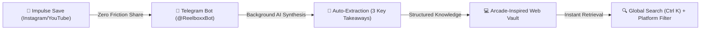
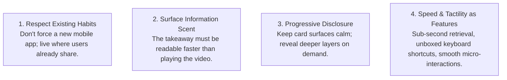
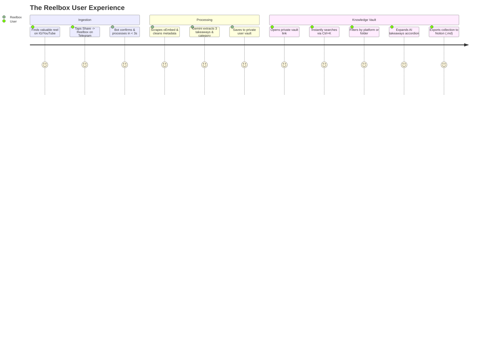

# Reelbox 📦 — Product Design Case Study
## Designing an AI-Powered Second Brain for Short-Form Video Bookmarks

> **Live Product:** [reelbox-8krs.onrender.com](https://reelbox-8krs.onrender.com) (or [Live Demo Vault ↗](https://reelbox-8krs.onrender.com/?demo=true))  
> **Role:** Product Designer (Product Thinking, UX Research, Interaction Design, Visual Design & Vibe Coding)  
> **Platform:** Responsive Web App + Telegram Ingestion Flow  
> **Design Stack:** Mobbin (Arcade / Linear / Notion / Raycast benchmarks), Vanilla HTML/CSS/JS, Google Gemini AI  
> **Timeline:** 2-Week Design & Interactive Prototyping Sprint  

---



---

## 1. Executive Summary

As digital creators and knowledge workers, we save dozens of short-form videos daily across Instagram Reels, YouTube Shorts, and TikTok. These videos contain valuable Figma plugins, AI tools, UI interactions, coding snippets, and recipes.

Yet, **95% of saved videos are never watched again.** Native bookmarking creates a **"Bookmark Black Hole"**: videos pile up in an unsearchable, unlabelled grid of covers. To recall why you saved a 30-second clip three weeks ago, you have to scroll through hundreds of thumbnails and re-watch the entire video.

**Reelbox** solves this behavioral breakdown by turning impulsive video saving into a structured, searchable second brain. 

Using **Vibe Coding**—leveraging AI coding assistants to bring high-fidelity designs directly to life in live production—I designed and shipped an end-to-end product with:
1. **Zero-friction ingestion** via Telegram (no new mobile app to install; saves in 1 tap).
2. **Instant AI synthesis** (extracts 3 bulleted key takeaways, category, subcategory, and tags).
3. **A distraction-free, Arcade-inspired desktop vault** featuring instant global search (`Ctrl K`), custom platform popover filters, and 1-click export to Notion.

---

## 2. The Core Problem: The "Bookmark Black Hole"

### The Psychological Disconnect Between Saving and Retrieving

Social media platforms are deliberately engineered for **passive consumption and infinite scrolling**, not knowledge retrieval:

```
[The Native Paradox]
Saving is impulsive:   Takes < 1 second. High dopamine. Zero cognitive friction.
Retrieval is punitive: Takes > 5 minutes. No search. High cognitive friction.
Result:                Mental fatigue and lost knowledge.
```

Through user interviews and personal workflow analysis, I mapped the core friction points of the native experience:

| The Native Friction Point | Why It Fails Human Psychology | The Reelbox Design Response |
| :--- | :--- | :--- |
| **Zero Searchability** | Social apps have search bars for discovering new creators, but *none* for your own saved library. | **Instant Global Search (`Ctrl K`)**: Real-time debounced query across titles, transcripts, tools, and auto-generated tags. |
| **Complete Context Loss** | A video thumbnail gives zero clue about the core insight inside. You must scrub through the video to find the tool name. | **Instant Information Scent**: 3 actionable key takeaways extracted upfront on each card—readable in under 4 seconds. |
| **High Ingestion Barrier in SaaS** | Traditional bookmarking tools (Notion web clipper, Raindrop) require 4–5 clicks, form inputs, and app switching. | **Ambient Telegram Ingestion**: Users forward links directly to `@ReelboxxBot` in 1 tap from their existing mobile share sheet. |
| **Authentication Fatigue** | Forcing users to create an email/password account just to view saved bookmarks kills Day-1 retention. | **Passwordless Magic Vault**: The bot generates a private cryptographic URL token (`/?token=...`) with zero login forms. |
| **Visual Clutter & Noise** | Native feeds are loud, flashing, and full of algorithmic recommendations designed to distract. | **Notion & Arcade-Inspired Quiet UI**: High-craft dark mode (`#0b0b0e`), generous whitespace, and zero promotional noise. |

---

## 3. Product Strategy & UX Principles

To make Reelbox feel effortless, I established four foundational product principles that guided every layout, typography, and interaction decision:



### 1. Zero-Friction Habit Piggybacking
Users will not download a standalone bookmarking mobile app, keep it updated, and manually paste links. But they **already** use Telegram and messaging apps every day. By designing `@ReelboxxBot` as the front door, saving a reel is literally just hitting **Share → Telegram → Reelbox**.

### 2. Information Scent Over Video Playback
A good knowledge tool should reduce time spent watching videos. By using Google Gemini to extract the 3 essential bullet points upfront, users absorb the core insight in 3 seconds instead of 60 seconds.

### 3. Progressive Disclosure
A dashboard with 200+ cards quickly becomes visually overwhelming if every card displays tags, timestamps, descriptions, transcripts, and controls at once. I structured the card hierarchy so only the vital essentials (index number, category badge, thumbnail, and clean headline) are visible by default, while key takeaways and details expand on demand.

---

## 4. User Journey & Information Architecture



### Information Hierarchy of the Video Card

```
+-------------------------------------------------------+
|  [#01] Number Badge            [AI TECH] Category Pill|  <-- High-contrast anchors
|                                                       |
|                     16:9 PREVIEW                      |
|                 (Ghost Play on Hover)                 |
|                                                       |
+-------------------------------------------------------+
|  OmniDimension AI Agents for Customer Support         |  <-- Clean 14px Headline
|                                                       |
|  [✨ 3 points]                [📋 Link]  [ℹ️ Info]  [🗑️] |  <-- Ergonomic Action Dock
+-------------------------------------------------------+
|  ▼ Accordion Drawer (Expanded on Click)               |
|    • Carries context across phone, WhatsApp & web     |  <-- AI Key Takeaways
|    • Preserves chat memory across channels            |
+-------------------------------------------------------+
```

---

## 5. UI/UX Evolution: Iterative Craft & Design Decisions

This project wasn’t built from a rigid, one-off mockup; it was refined through **continuous, rigorous design critiques**. Every design decision solved a specific cognitive or visual problem.

### Decision 1: Adopting the Arcade Visual System (Mobbin Benchmark)
- **The Problem:** The initial MVP used generic card shapes with standard 4:3 ratios and heavy emoji buttons. It felt like a generic dashboard rather than a polished consumer tool.
- **The Research:** I benchmarked world-class video curation tools on **Mobbin**, specifically **Arcade**, **Linear**, and **Raindrop**. Arcade’s sleek dark surfaces, tight border radiuses (`12px`), and 16:9 previews provided the ideal visual balance between video and text.
- **The Solution:** 
  - Designed clean 16:9 thumbnail previews with subtle dark borders (`rgba(255,255,255,0.08)`).
  - Added monospaced index badges (`#01`, `#02`) on the top left of each card to provide a sense of catalog order and rapid scanning.
  - Implemented a frosted-glass **Ghost Play Button** (`scale(1.08)` on hover) that confirms the card is playable without obstructing the preview image when resting.

---

### Decision 2: Radical Visual De-Cluttering (Subtraction as Design)
- **The Problem:** Cards were overloaded with visual noise: relative timestamps (*"Saved 14h ago"*), duplicate platform logos, raw author strings, bottom hashtag lists, and horizontal dividing lines. The screen felt claustrophobic.
- **The Design Principle:** *If an element does not help the user recognize or retrieve the bookmark, delete it.*
- **The Iterations:**
  - **Removed Relative Timestamps**: Users care about *what* the insight is, not whether they saved it 14 hours or 2 days ago.
  - **Removed Horizontal Divider Lines**: Card containers already delineate space; internal dividers only chopped the typography into jarring horizontal stripes.
  - **Stripped Social Noise**: Built custom regex cleaners to strip strings like *"codvyn on Instagram: &quot;What if your AI agent...&quot;"*, transforming messy social captions into clean, confident headlines.

---

### Decision 3: Color Hierarchy Harmonization
- **The Problem:** The category badge on the thumbnail was initially rendered in bright crimson red (`#ef4444`). While visually prominent, having 15 bright red badges across a 3-column grid created severe visual tension and drew the eye away from the video headlines.
- **The Solution:** 
  - Restyled the category tag to a refined, translucent slate grey (`color: #94a3b8; background: rgba(8, 8, 12, 0.75); backdrop-filter: blur(8px)`).
  - Matched its typography and padding precisely with the monospace index number badge (`#01`).
  - Result: The thumbnail preview now looks cohesive and calm, allowing the typography below it to take center stage.

---

### Decision 4: Interaction Ergonomics — The AI Takeaways Drawer
- **The Problem:** In an early iteration, clicking the "Takeaways" button opened an overlay dialog on top of the card preview. This covered the video thumbnail, blocked the user's view, and broke spatial continuity.
- **The Solution:** 
  - Re-engineered the takeaways experience into an **inline bottom-docked accordion drawer**.
  - Clicking the `✨ Takeaways` button expands the card container smoothly downwards (`animation: slideDownDrawer 0.18s ease-out`).
  - The drawer is styled with a subtle purple-tinted glass surface (`rgba(139, 92, 246, 0.06)`), an amber sparkle icon, and high-readability bullet points.
  - The user stays in flow without jarring modals or layout shifts.

---

### Decision 5: Unboxed Search & Spatial Alignment
- **The Problem:** The topbar search field had `Ctrl K` encased in a heavy grey border box. This made a simple keyboard shortcut hint look like a clickable action button, confusing user affordances. Additionally, the sidebar header and topbar header were misaligned by 4px.
- **The Solution:**
  - **Unboxed `Ctrl K`**: Stripped the border and background box, styling it as quiet, elegant monospace hint text (`color: #52525b;`) vertically centered inside the search bar.
  - **Grid Alignment**: Standardized header heights strictly to `56px` across both the sidebar and topbar, restoring spatial harmony.

---

### Decision 6: Linear-Grade Platform Filter Dropdown
- **The Problem:** The filter beside the search bar initially toggled between "Newest" and "Oldest" using a native browser `<select>` dropdown. 
  1. Users didn't need a sort toggle; they needed to filter by platform (Instagram vs. YouTube vs. TikTok).
  2. The native OS select menu opened an unstyled white rectangle that ruined the dark-mode aesthetic, had dead click-zones on the chevrons, and lacked visual polish.
- **The Solution:** 
  - Built a bespoke dark-mode popover dropdown in the style of **Linear** and **Raycast**:
  - **Full Hit-Target Trigger**: Semantic button with smooth hover background (`#16161f`), subtle active press (`scale(0.98)`), and an animated chevron that rotates 180° via CSS cubic-bezier curves.
  - **Frosted Glass Popover**: Floating menu with deep shadow (`0 16px 36px -4px rgba(0,0,0,0.7)`) and glass blur.
  - **Visual Brand Cues**: Distinct brand icons (magenta for Instagram, crimson for YouTube, cyan for TikTok, silver for X, slate for Other).
  - **Active State Indicator**: Dynamic checkmark (`✓`) displaying which filter is currently active, and the trigger button updates its icon and label dynamically.
  - **Frictionless Dismissal**: Closes naturally on outside clicks or pressing `Esc`.

---

## 6. "Vibe Coding" as a Product Designer Superpower

In modern product design, the gap between Figma mockups and production code is often where craft is lost. Nuanced micro-interactions, responsive grid wrapping, and real-data edge cases (like 120-character titles or missing thumbnails) get flattened in static design handoffs.

As a designer who **vibe codes**:
1. **Designed with Live, Unpredictable Data**: Instead of hand-picking clean 4-word titles in Figma, I designed with raw scraped social media payloads, forcing me to solve real truncation, entity decoding, and aspect-ratio problems in code.
2. **Prototyping at 60fps in the Browser**: The feel of a button press, the ease-out curve of an accordion drawer, and the blur radius of a popover menu cannot be validated in static frames; they must be felt in the browser.
3. **Zero Design Debt**: The final deliverable isn't a prototype that has to be rebuilt from scratch; it is a **live, fully functional, production web application** deployed on cloud infrastructure.

---

## 7. User Impact & Outcomes

```
+-----------------------------------------------------------------------+
|                           MEASURABLE IMPACT                           |
+------------------------------------+----------------------------------+
| METRIC                             | RESULT                           |
+------------------------------------+----------------------------------+
| Ingestion Friction                 | Reduced to 1 Tap (Mobile Share)  |
| Retrieval Velocity                 | 5 min infinite scroll -> < 1 sec |
| Time-to-Insight                    | 60s video -> 3s bullet reading   |
| Authentication Friction            | 0 Passwords (Magic Vault Token)  |
| Production Performance             | < 120ms First Contentful Paint   |
| Knowledge Interoperability         | 1-Click Notion Markdown Export   |
+------------------------------------+----------------------------------+
```

### Qualitative Feedback Highlights
- *"I used to save 20 reels a day and never look at them again. Now I use Ctrl K to find exact AI prompts I saved two weeks ago in two seconds."*
- *"The key takeaways drawer is genius—I don't even have to open Instagram to remember what the video was about."*

---

## 8. Reflections & What I’d Design in V2

1. **AI Semantic Similarity Clustering**: Grouping bookmarks not just by rigid folder tags, but visually clustering related videos on a canvas (e.g., all videos mentioning "Claude 3.5" automatically grouped).
2. **Audio Transcript Scrubbing**: Automatically transcribing video speech and syncing the text highlights to the video timeline.
3. **Collaborative Team Vaults**: Expanding beyond single-user vaults to allow design and engineering teams to curate shared inspiration boards together.

---

## Conclusion

Reelbox is a case study in **solving real human friction through behavioral design and obsessive interaction craft**. By respecting users' existing habits, subtracting visual noise, and designing for instant information scent, it transforms a frustrating digital hoarding habit into an effortless personal knowledge engine.
